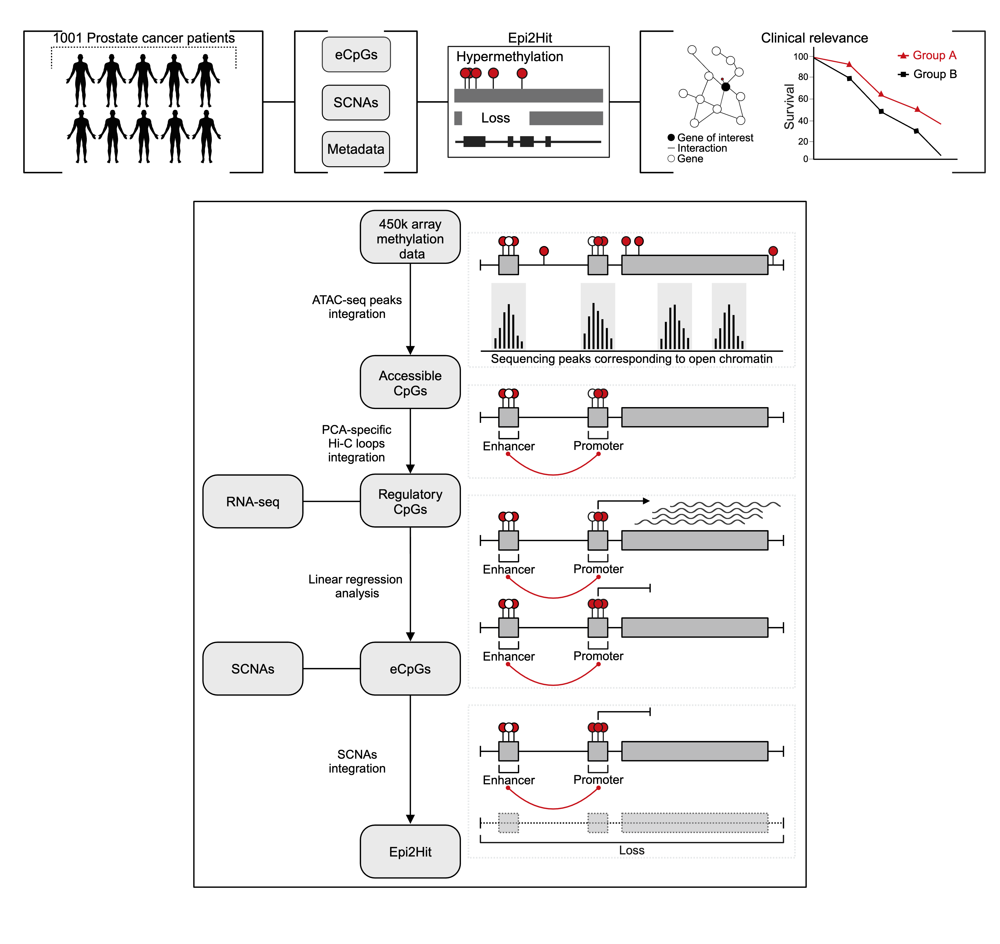

# Epi2Hit workflow

**Epi2Hit** is an integrative computational method that leverages DNA sequencing, epigenomic profiling, gene expression, chromatin accessibility, and Hi-C data to identify biallelic inactivation of tumor suppressor genes. This workflow identifies cases where one allele undergoes DNA methylation in promoter and enhancer regions, while the other allele is affected by genomic loss. 

## Repository Structure

- **analysis/**: Contains the primary code for the workflow.
  - `Epi2Hit.ipynb`: Jupyter Notebook illustrating the steps of the workflow, including function calls and intermediate plots.
  - `Epi2Hit.py`: Python script with functions used in the workflow.
  
- **data/**: Contains some publicly available data sets used in the analysis.

